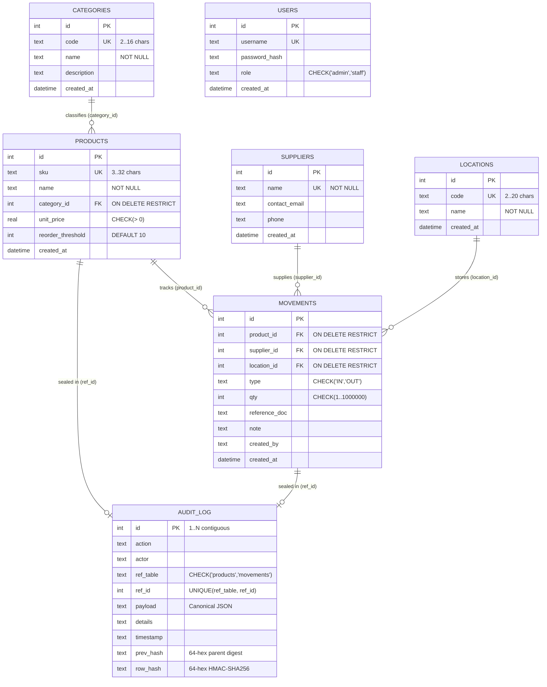
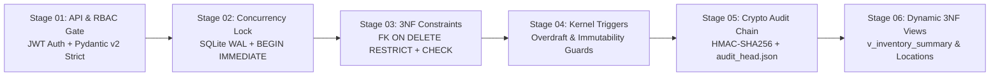

## Index

1. [Core Idea & Universal DBMS Framework](#1-core-idea--universal-dbms-framework)
2. [Feature Overview](#2-feature-overview)
3. [Relational Database Design (3NF Schema, Views & Triggers)](#3-relational-database-design-3nf-schema-views--triggers)
   - [3.1 Entity-Relationship (ER) Diagram](#31-entity-relationship-er-diagram)
   - [3.2 Physical Tables (7 Entities)](#32-physical-tables-7-entities)
   - [3.3 Normalization Proof (1NF, 2NF, 3NF)](#33-normalization-proof-1nf-2nf-3nf)
   - [3.4 Compiled Relational Views (4 Views)](#34-compiled-relational-views-4-views)
   - [3.5 Storage-Layer Triggers (7 Guards)](#35-storage-layer-triggers-7-guards)
   - [3.6 Indexes & Concurrency PRAGMAs](#36-indexes--concurrency-pragmas)
4. [Data Request Flow & 6-Stage Defense-in-Depth Architecture](#4-data-request-flow--6-stage-defense-in-depth-architecture)
   - [4.1 End-to-End Request Pipeline](#41-end-to-end-request-pipeline)
   - [4.2 Atomic Warehouse Transfer Workflow](#42-atomic-warehouse-transfer-workflow)
   - [4.3 Cryptographic Audit Chain & 5-Point Verifier](#43-cryptographic-audit-chain--5-point-verifier)
5. [Application Architecture, REST API & Direct Terminal Shell](#5-application-architecture-rest-api--direct-terminal-shell)
   - [5.1 Module Responsibilities](#51-module-responsibilities)
   - [5.2 REST API Endpoints](#52-rest-api-endpoints)
   - [5.3 Direct CLI SQLite Terminal (`inspect_db.py`)](#53-direct-cli-sqlite-terminal-inspect_dbpy)
   - [5.4 4-Tab Web Interface](#54-4-tab-web-interface)
6. [Automated Verification & Testing (`25 / 25 Passed`)](#6-automated-verification--testing-25--25-passed)
7. [Summary](#7-summary)

---

## 1. Core Idea & Universal DBMS Framework

### The Problem with Traditional CRUD Databases
Conventional resource-tracking databases store availability as a mutable counter column and overwrite it in place:
```sql
UPDATE products SET stock = stock - 5 WHERE id = 1;
```
This anti-pattern introduces three fundamental database flaws:
1. **Loss of Historical Provenance**: Overwriting a counter destroys the history of *who* changed the state, *when*, and *at which location*.
2. **Lost-Update & Overdraft Race Conditions**: Concurrent requests reading the same counter before writing can double-book or drive balances negative.
3. **Silent Insider Tampering**: Anyone with database access can alter balances or erase records without leaving forensic evidence.

### The VaultStock Solution: Append-Only Relational State Framework
**VaultStock** eliminates mutable stock columns entirely. The `products` table stores only catalog metadata, while every inward receipt (`IN`), outward dispatch (`OUT`), and inter-location transfer (`OUT` + `IN`) is recorded as an **immutable row** in `movements`. Current balances—both global and per-location—are derived dynamically in real time via SQL views (`SUM(IN) - SUM(OUT)`), enforced at the storage kernel by SQLite triggers, and sealed into an **HMAC-SHA256 hash chain** (similar to Git commits).

### Adaptability Across DBMS Domains
While demonstrated using warehouse inventory, this 7-table **3NF + Immutable Ledger + Derived View** schema is a **domain-agnostic DBMS framework** that directly models any resource-allocation system without schema changes:

| Core 3NF Table | Framework Role | Inventory / Retail | Hospital / Blood Bank | University Library | Food Ordering / Cloud Kitchen | Ride / Fleet Booking |
| :--- | :--- | :--- | :--- | :--- | :--- | :--- |
| `categories` | **Resource Class (1:N)** | Hardware, Networking | Blood Groups, Drug Schedules | Book Genres, Reference | Cold Chain, Fresh Produce | Sedan, SUV, EV Tier |
| `products` | **Catalog Entity (1:N)** | Commercial SKUs | Medicine Vials, Blood Units | ISBN Book Titles | Menu / Pantry Portion SKUs | Vehicle / Asset Models |
| `suppliers` | **Inbound Source (1:N)** | Wholesale Vendors | Pharma Labs, Blood Donors | Publishers, Donors | Farms, Central Commissaries | Fleet Onboarding Partners |
| `locations` | **Physical Node (1:N)** | Warehouses, Retail Floors | ICU, ER, Central Pharmacy | Main & Dept Libraries | Dark Stores, Kitchen Hubs | City Zones, Depots |
| `movements` | **State Transition Log** | Receive, Issue, Transfer | Restock, Dispense, Ward Xfer | Acquire, Borrow, Inter-Loan | Prep Intake, Order, Hub Xfer | Park (`IN`), Dispatch (`OUT`), Re-zone |
| `v_location_inventory` | **Node State (`SUM`)** | Stock per Warehouse | Vials per Hospital Ward | Copies per Library Branch | Portions per Kitchen Hub | Available Vehicles per Zone |
| `audit_log` | **Forensic Chain (1:1)** | Financial Audit Trail | Controlled-Substance Log | Asset Custody Chain | Food Safety Compliance | Dispatch & Custody Ledger |

---

## 2. Feature Overview

| # | Feature | DBMS / Architectural Mechanism |
| :--- | :--- | :--- |
| 1 | **Zero Mutable Stock Column** | Global and per-warehouse balances are derived on the fly via `v_inventory_summary` and `v_location_inventory` (`SUM(IN) - SUM(OUT)`). |
| 2 | **Multi-Location Stock & Atomic Transfers** | Tracks exact balance per `(product_id, location_id)` and executes inter-warehouse transfers (`OUT` from source + `IN` to destination) inside one atomic `BEGIN IMMEDIATE` transaction. |
| 3 | **Trigger-Enforced Immutability** | `BEFORE UPDATE` and `BEFORE DELETE` triggers on `movements`, `products`, and `audit_log` abort any attempt to modify or delete historical records. |
| 4 | **Global & Location Overdraft Guard** | `prevent_negative_stock` (`BEFORE INSERT` trigger) rejects any `OUT` movement if either global stock or the specific source location's stock is insufficient. |
| 5 | **3NF Normalized Schema** | 7 physical tables with strict domain `CHECK` constraints and `FOREIGN KEY ... ON DELETE RESTRICT` referential integrity. |
| 6 | **HMAC-SHA256 Cryptographic Audit Chain** | Every catalog creation and stock movement is signed with a secret HMAC key and chained via `prev_hash -> row_hash`. |
| 7 | **5-Point Mathematical Verifier** | Verifies **Contiguity** ($1..N$), **Hash Linkage**, **HMAC Digest**, **Table-to-Audit JSON Reconciliation**, and **Out-of-Band Head Anchor** (`data/audit_head.json`). |
| 8 | **Direct CLI SQLite Terminal** | `python inspect_db.py --shell` opens a live interactive `sqlite>` prompt with dot-commands (`.tables`, `.views`, `.triggers`, `.schema`) and raw SQL execution. |
| 9 | **Live Crow's Foot ER Diagram & Probes** | Dynamically generates an SVG Crow's Foot ER diagram from `PRAGMA` metadata and executes safe trigger/query-plan probes. |
| 10 | **Role-Based Access Control (RBAC)** | Salted PBKDF2-HMAC-SHA256 (150k iterations) password hashing, sliding-window login rate limiting, and `HS256` JWT roles (`admin` vs `staff`). |

---

## 3. Relational Database Design (3NF Schema, Views & Triggers)

### 3.1 Entity-Relationship (ER) Diagram



### 3.2 Physical Tables (7 Entities)

| Table | Primary Key | Foreign Keys | Domain & Integrity Constraints |
| :--- | :--- | :--- | :--- |
| [`users`](file:///d:/DBMS%20Project/Vaultstock-main/db/schema.sql#L7-L13) | `id` | — | `username UNIQUE`, `role IN ('admin', 'staff')` |
| [`categories`](file:///d:/DBMS%20Project/Vaultstock-main/db/schema.sql#L16-L22) | `id` | — | `code UNIQUE` (2–16 chars), `name` (1–80 chars) |
| [`suppliers`](file:///d:/DBMS%20Project/Vaultstock-main/db/schema.sql#L25-L31) | `id` | — | `name UNIQUE` (2–100 chars) |
| [`locations`](file:///d:/DBMS%20Project/Vaultstock-main/db/schema.sql#L34-L39) | `id` | — | `code UNIQUE` (2–20 chars), `name` (1–80 chars) |
| [`products`](file:///d:/DBMS%20Project/Vaultstock-main/db/schema.sql#L42-L50) | `id` | `category_id` $\rightarrow$ `categories(id)` | `sku UNIQUE`, `unit_price > 0`, `reorder_threshold >= 0`, `ON DELETE RESTRICT` |
| [`movements`](file:///d:/DBMS%20Project/Vaultstock-main/db/schema.sql#L69-L80) | `id` | `product_id`, `supplier_id`, `location_id` | `type IN ('IN', 'OUT')`, integer `qty BETWEEN 1 AND 1000000`, `ON DELETE RESTRICT` |
| [`audit_log`](file:///d:/DBMS%20Project/Vaultstock-main/db/schema.sql#L111-L123) | `id` | Logical 1:1 (`ref_table, ref_id`) | `ref_table IN ('products', 'movements')`, `UNIQUE(ref_table, ref_id)` |

### 3.3 Normalization Proof (1NF, 2NF, 3NF)
- **First Normal Form (1NF)**: All attributes are atomic scalar values; repeating groups are absent, and every relation has a surrogate integer primary key (`id`).
- **Second Normal Form (2NF)**: Every table uses a single-attribute primary key (`id`), so no non-prime attribute can be partially dependent on a composite key.
- **Third Normal Form (3NF)**: Every non-key attribute depends solely on the primary key (`id`) and nothing else:
  - Category names/codes live strictly in `categories` (`products.category_id` references `categories.id`).
  - Supplier contact details live strictly in `suppliers` (`movements.supplier_id` references `suppliers.id`).
  - Location names/codes live strictly in `locations` (`movements.location_id` references `locations.id`).
  - **Elimination of Derived Redundancy**: Storing `current_stock` or `total_valuation` on `products` would violate strict normalization and create update anomalies. Instead, they are computed dynamically via relational views.

### 3.4 Compiled Relational Views (4 Views)

| View Name | SQL Purpose & Derivation Logic |
| :--- | :--- |
| [`v_inventory_summary`](file:///d:/DBMS%20Project/Vaultstock-main/db/schema.sql#L143-L163) | Joins `products`, `categories`, and `movements` to compute `current_stock = COALESCE(SUM(CASE WHEN type='IN' THEN qty ELSE -qty END), 0)`, `total_valuation = ROUND(current_stock * unit_price, 2)`, and `is_low_stock`. |
| [`v_location_inventory`](file:///d:/DBMS%20Project/Vaultstock-main/db/schema.sql#L195-L207) | Groups `movements` by `(product_id, location_id)` to derive exact stock balances at each individual warehouse or retail location (`HAVING current_stock > 0`). |
| [`v_low_stock_alerts`](file:///d:/DBMS%20Project/Vaultstock-main/db/schema.sql#L166-L167) | Filters `v_inventory_summary WHERE is_low_stock = 1` (`current_stock <= reorder_threshold`). |
| [`v_ledger_history`](file:///d:/DBMS%20Project/Vaultstock-main/db/schema.sql#L170-L191) | Enriches `movements` with joined product SKU/name, category name, supplier name, and location code/name in reverse chronological order. |

### 3.5 Storage-Layer Triggers (7 Guards)

| Trigger Name | Target Table | Event | Enforcement Rule |
| :--- | :--- | :--- | :--- |
| [`prevent_negative_stock`](file:///d:/DBMS%20Project/Vaultstock-main/db/schema.sql#L89-L99) | `movements` | `BEFORE INSERT` (`type='OUT'`) | Aborts with `SECURITY VIOLATION: Insufficient stock.` if either the product's global balance or the specified `location_id` balance is less than `NEW.qty`. |
| [`prevent_movement_update`](file:///d:/DBMS%20Project/Vaultstock-main/db/schema.sql#L102-L106) | `movements` | `BEFORE UPDATE` | Unconditionally aborts—historical ledger entries cannot be altered. |
| [`prevent_movement_delete`](file:///d:/DBMS%20Project/Vaultstock-main/db/schema.sql#L108-L112) | `movements` | `BEFORE DELETE` | Unconditionally aborts—historical ledger entries cannot be erased. |
| [`prevent_product_update`](file:///d:/DBMS%20Project/Vaultstock-main/db/schema.sql#L61-L66) | `products` | `BEFORE UPDATE` | Unconditionally aborts—protects historic unit prices and audit snapshot reconciliation. |
| [`prevent_product_delete`](file:///d:/DBMS%20Project/Vaultstock-main/db/schema.sql#L55-L59) | `products` | `BEFORE DELETE` | Unconditionally aborts—preserves referential integrity for historical movements. |
| [`prevent_audit_update`](file:///d:/DBMS%20Project/Vaultstock-main/db/schema.sql#L129-L133) | `audit_log` | `BEFORE UPDATE` | Unconditionally aborts—cryptographic audit blocks are append-only. |
| [`prevent_audit_delete`](file:///d:/DBMS%20Project/Vaultstock-main/db/schema.sql#L135-L139) | `audit_log` | `BEFORE DELETE` | Unconditionally aborts—cryptographic audit blocks cannot be deleted. |

### 3.6 Indexes & Concurrency PRAGMAs
- **B-Tree Indexes**: `idx_products_category_id`, `idx_movements_product_id`, `idx_movements_supplier_id`, and `idx_movements_location_id` accelerate foreign-key joins and `SUM()` aggregations in views and triggers.
- **Engine Configuration ([`get_connection()`](file:///d:/DBMS%20Project/Vaultstock-main/api/db.py#L24-L31))**:
  - `PRAGMA foreign_keys = ON;` — Enforces relational foreign key constraints on every connection.
  - `PRAGMA journal_mode = WAL;` — Write-Ahead Logging allows concurrent readers alongside writers.
  - `PRAGMA busy_timeout = 10000;` — Queues concurrent lock requests for up to 10 seconds instead of failing immediately.
  - `BEGIN IMMEDIATE` ([`write_tx()`](file:///d:/DBMS%20Project/Vaultstock-main/api/db.py#L34-L43)) — Acquires the write lock *before* reading current stock balances, preventing race-condition overdrafts.

---

## 4. Data Request Flow & 6-Stage Defense-in-Depth Architecture

### 4.1 End-to-End Request Pipeline



1. **Stage 01 — Request & RBAC Gate ([`api/main.py`](file:///d:/DBMS%20Project/Vaultstock-main/api/main.py))**: Authenticates the `Bearer` JWT (`HS256`), checks the user's live role in `users` (`admin` vs `staff`), and validates request bodies through strict Pydantic v2 models (`extra="forbid"`, control-character filtering, integer bounds, and `NaN`/`Infinity` rejection).
2. **Stage 02 — Immediate Write Lock ([`api/db.py`](file:///d:/DBMS%20Project/Vaultstock-main/api/db.py))**: Opens an atomic transaction with `BEGIN IMMEDIATE`, serializing concurrent writers so two simultaneous dispatches cannot read stale stock balances.
3. **Stage 03 — 3NF Relational Constraints ([`db/schema.sql`](file:///d:/DBMS%20Project/Vaultstock-main/db/schema.sql))**: SQLite verifies foreign keys (`product_id`, `category_id`, `supplier_id`, `location_id`) and column `CHECK` constraints (`qty >= 1`, `type IN ('IN','OUT')`).
4. **Stage 04 — Storage-Kernel Triggers ([`db/schema.sql`](file:///d:/DBMS%20Project/Vaultstock-main/db/schema.sql))**: Even if an attacker or script bypasses the FastAPI layer and runs raw SQL against the database, `prevent_negative_stock` blocks overdrafts (globally and per warehouse) and `BEFORE UPDATE/DELETE` triggers block tampering with existing rows.
5. **Stage 05 — Cryptographic HMAC Chain & External Anchor ([`api/db.py`](file:///d:/DBMS%20Project/Vaultstock-main/api/db.py))**: Before committing, the transaction signs a canonical JSON snapshot of the new row together with the previous block's hash (`prev_hash`) using a secret `HMAC-SHA256` key and updates the external checkpoint `data/audit_head.json`.
6. **Stage 06 — Dynamic 3NF Read Views**: Subsequent reads query `v_inventory_summary` and `v_location_inventory`, guaranteeing that displayed balances always reconcile 100% with the immutable movement history.

### 4.2 Atomic Warehouse Transfer Workflow
When transferring stock between two warehouses (`POST /api/movements/transfer`), VaultStock does not mutate a location column. Instead, inside a single `BEGIN IMMEDIATE` transaction, it:
1. Verifies `from_location_id != to_location_id` and confirms `from_location_id` holds at least `qty` units of `product_id`.
2. Inserts an `OUT` movement on `from_location_id` + seals a `STOCK_TRANSFER_OUT` audit block.
3. Inserts an `IN` movement on `to_location_id` + seals a `STOCK_TRANSFER_IN` audit block.
4. Commits both entries atomically—preserving global stock (`SUM(IN) - SUM(OUT)` remains constant) while shifting location balances in `v_location_inventory`.

### 4.3 Cryptographic Audit Chain & 5-Point Verifier
Each block in `audit_log` computes its digest over an 8-element canonical JSON array using the secret key $K$ (`data/.audit_key`):

$$\text{row\_hash} = \text{HMAC-SHA256}_{K}\big(\,[\text{prev\_hash},\ \text{id},\ \text{action},\ \text{actor},\ \text{ref\_table},\ \text{ref\_id},\ \text{payload},\ \text{timestamp}]\,\big)$$

Calling `GET /api/audit/verify` ([`verify_audit_chain()`](file:///d:/DBMS%20Project/Vaultstock-main/api/db.py#L177-L306)) evaluates five mathematical invariants across the entire database:
1. **01. Contiguity ($1..N$)**: Ensures block IDs form an unbroken sequence $1, 2, \dots, N$ with no deleted middle blocks.
2. **02. Hash Linkage**: Confirms every block's `prev_hash` equals the preceding block's `row_hash`.
3. **03. HMAC-SHA256 Digest**: Recomputes the keyed HMAC for every block and compares it in constant time (`hmac.compare_digest`), catching direct disk edits or unkeyed SHA-256 forgeries.
4. **04. Relational Reconciliation**: Rebuilds the canonical JSON for every row in `products` and `movements` and verifies a 1:1 match with `audit_log`, catching unlogged "ghost" inserts or direct table edits.
5. **05. Out-of-Band Head Anchor**: Compares the latest block in `audit_log` against `data/audit_head.json`, catching tail-truncation attacks where the newest blocks and movements are deleted together.

---

## 5. Application Architecture, REST API & Direct Terminal Shell

### 5.1 Module Responsibilities

| File | Role |
| :--- | :--- |
| [`run_dev.py`](file:///d:/DBMS%20Project/Vaultstock-main/run_dev.py) | Launches both the Frontend HTTP server (`localhost:3000` with strict CSP headers) and the FastAPI Uvicorn server (`localhost:8000`). |
| [`db/schema.sql`](file:///d:/DBMS%20Project/Vaultstock-main/db/schema.sql) | Defines the 7 normalized 3NF tables, 4 indexes, 7 immutability/overdraft triggers, and 4 relational views. |
| [`api/config.py`](file:///d:/DBMS%20Project/Vaultstock-main/api/config.py) | Loads environment settings and auto-generates persistent 256-bit secrets (`data/.jwt_secret`, `data/.audit_key`). |
| [`api/security.py`](file:///d:/DBMS%20Project/Vaultstock-main/api/security.py) | Implements salted `PBKDF2-HMAC-SHA256` (150,000 iterations) and constant-time dummy verification against timing attacks. |
| [`api/db.py`](file:///d:/DBMS%20Project/Vaultstock-main/api/db.py) | Manages WAL connections, `write_tx()`, database seeding, HMAC block chaining, the 5-point verifier, tamper simulation, and SQL probes. |
| [`api/main.py`](file:///d:/DBMS%20Project/Vaultstock-main/api/main.py) | Defines REST endpoints, Pydantic v2 validation schemas, JWT RBAC dependencies, and sliding-window login rate limiting. |
| [`web/index.html`](file:///d:/DBMS%20Project/Vaultstock-main/web/index.html), [`web/app.js`](file:///d:/DBMS%20Project/Vaultstock-main/web/app.js), [`web/style.css`](file:///d:/DBMS%20Project/Vaultstock-main/web/style.css) | 4-tab responsive Bento-Grid Single-Page Application in a Matte Stone / Graphite palette (Light & Dark modes). |
| [`inspect_db.py`](file:///d:/DBMS%20Project/Vaultstock-main/inspect_db.py) | CLI database inspector and interactive `sqlite>` terminal shell for direct faculty SQL evaluation. |
| [`extras/test_suite.py`](file:///d:/DBMS%20Project/Vaultstock-main/extras/test_suite.py) | Automated 25-step security, relational, trigger, and functional test suite. |

### 5.2 REST API Endpoints

| Method | Endpoint | Role | Description |
| :--- | :--- | :--- | :--- |
| `POST` | `/api/login` | Public | Authenticates user credentials and returns a signed `HS256` JWT. |
| `GET` | `/api/config` | Public | Returns runtime metadata (`demo_mode`, `version`). |
| `GET` | `/api/me` | Any | Returns authenticated user profile and active role. |
| `GET` | `/api/categories`, `/api/suppliers`, `/api/locations` | Any | Lists 3NF master reference entities. |
| `GET` | `/api/products` | Any | Lists catalog SKUs with live derived stock and valuation from `v_inventory_summary`. |
| `POST` | `/api/products` | Admin | Registers a new product SKU and seals a `PRODUCT_CREATE` audit block. |
| `GET` | `/api/inventory/locations` | Any | Lists per-warehouse stock balances from `v_location_inventory`. |
| `GET` | `/api/inventory/alerts` | Any | Lists low-stock items where `current_stock <= reorder_threshold` from `v_low_stock_alerts`. |
| `GET` | `/api/movements` | Any | Lists enriched movement history from `v_ledger_history`. |
| `POST` | `/api/movements` | Any | Records an `IN` receipt or `OUT` dispatch (with warehouse balance verification) and seals an audit block. |
| `POST` | `/api/movements/transfer` | Any | Atomically transfers stock between two warehouses (`OUT` + `IN`) and seals paired audit blocks. |
| `GET` | `/api/audit` | Any | Lists chained cryptographic audit blocks from `audit_log`. |
| `GET` | `/api/audit/verify` | Any | Executes the 5-point mathematical verification scan across the database and anchor file. |
| `GET` | `/api/debug/internals` | Any | Returns SQLite engine PRAGMAs, table row counts, compiled views, and active triggers. |
| `GET` | `/api/debug/full-schema` | Any | Returns full schema metadata for the generated SVG Crow's Foot ER diagram. |
| `GET` | `/api/debug/table/{name}` | Any | Inspects columns, foreign keys, DDL, and raw rows of an allow-listed table or view. |
| `POST` | `/api/debug/sql-probe` | Any | Executes a safe `EXPLAIN QUERY PLAN` or storage trigger interception probe. |
| `POST` | `/api/audit/tamper-demo` | Admin | *(Demo Mode)* Simulates direct disk-level tampering on Block #1 using an unkeyed SHA-256 hash. |
| `POST` | `/api/reset-demo` | Admin | *(Demo Mode)* Drops, vacuums, and cleanly reseeds the database to its 12-block baseline. |

### 5.3 Direct CLI SQLite Terminal (`inspect_db.py`)
For direct database evaluation during a viva, faculty can run raw SQL statements directly against `data/vaultstock.db` from the terminal with `PRAGMA foreign_keys = ON` and all triggers active:

```powershell
# 1. Open the interactive SQLite prompt (sqlite>)
python inspect_db.py --shell

# 2. Execute a single raw SQL query directly from PowerShell/Bash
python inspect_db.py -c "SELECT * FROM v_location_inventory;"

# 3. Dump schema, foreign keys, and rows for a specific table/view (or all objects)
python inspect_db.py movements
python inspect_db.py
```
Inside `python inspect_db.py --shell`, evaluators can use `.help`, `.tables`, `.views`, `.triggers`, `.schema [name]`, `.dump <name>`, or type any raw SQL (`SELECT`, `INSERT`, `UPDATE`, `DELETE`, `PRAGMA`, `EXPLAIN QUERY PLAN`) to observe real-time ASCII tables and storage-trigger interceptions.

### 5.4 4-Tab Web Interface
1. **Inventory**: Displays 4 KPI summary tiles, a dynamic low-stock alert banner, and the catalog table showing per-warehouse stock badges (`WH-A1: 25`, `WH-B2: 15`) and quick `+ IN`, `- OUT`, and `↔ Transfer` action buttons.
2. **Operations**: Features three side-by-side operational forms—**Stock Receipt (IN)**, **Stock Dispatch (OUT)** (with live per-location balance check), and **Warehouse Transfer (`LOC → LOC`)**—above the chronological **Append-Only Movement Ledger**.
3. **Audit Chain**: Presents a streamlined verification bar with the 5-point check pills, the **6-Stage Data Request & Defense-in-Depth Flowchart**, Tamper/Reset controls, and the live table of HMAC-SHA256 blocks.
4. **ER Diagram & Schema**: Renders engine telemetry tiles, an interactive **Crow's Foot SVG ER Diagram** generated from live SQLite `PRAGMA` introspection, a **Live Table & View Explorer** (columns, PK/FK constraints, DDL, and raw rows for all 7 tables and 4 views), and **Interactive SQL & Trigger Probes**.

---

## 6. Automated Verification & Testing (`25 / 25 Passed`)

Running `python extras/test_suite.py` provisions an isolated test database (`data/vaultstock_test.db`) and executes 25 automated checks across security, relational constraints, triggers, tamper detection, and inventory workflows:

| Category | Test IDs | What is Verified |
| :--- | :--- | :--- |
| **Authentication & RBAC** | `T1` – `T5` | Unauthenticated `401` rejection, valid JWT profile resolution, `staff` `403` rejection on admin routes, forged JWT secret rejection, and expired JWT rejection. |
| **Input & Relational Constraints** | `T6` – `T8`, `T18` | Safe XSS string handling, invalid foreign-key `category_id` rejection, overdraft rejection (`Insufficient inventory`), and duplicate SKU `409` handling. |
| **Storage-Layer Immutability Triggers** | `T9` – `T11` | Direct SQL `UPDATE` and `DELETE` blocked on `movements`, `audit_log`, and `products` by SQLite `BEFORE` triggers. |
| **Cryptographic Tamper Detection** | `T12` – `T17` | Detects file-level trigger bypass with unkeyed SHA-256 (`T12`), unlogged ghost movement rows (`T13`), deleted middle audit blocks (`T14`), tail truncation via external anchor (`T15`), missing anchor file (`T16`), and corrupted JSON payloads (`T17`). |
| **3NF Views & Core Workflows** | `T19` – `T20`, `F1` – `F5` | Seeded 3NF lookup counts (`T19`), `v_inventory_summary` derivation (`T20`), dynamic `SUM(IN) - SUM(OUT)` math (`F1`), low-stock alert reactivity (`F2`), 100% audit chain verification (`F3`), clean database reset (`F4`), and atomic inter-warehouse stock transfer updating `v_location_inventory` while preserving global stock and audit integrity (`F5`). |

---

## 7. Summary

**VaultStock** demonstrates how a rigorous **Third Normal Form (3NF) relational schema**, **append-only event ledger**, **SQLite storage triggers**, and **HMAC-SHA256 cryptographic chaining** work together as a unified database framework. By deriving resource balances dynamically (`SUM(IN) - SUM(OUT)`) both globally (`v_inventory_summary`) and per location (`v_location_inventory`) rather than mutating a counter in place, the system guarantees complete historical traceability, prevents race-condition overdrafts, and detects even direct disk-level database tampering—providing a reusable blueprint for any mission-critical DBMS application.
