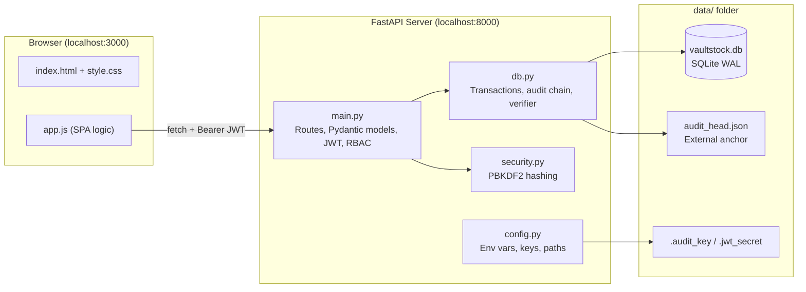
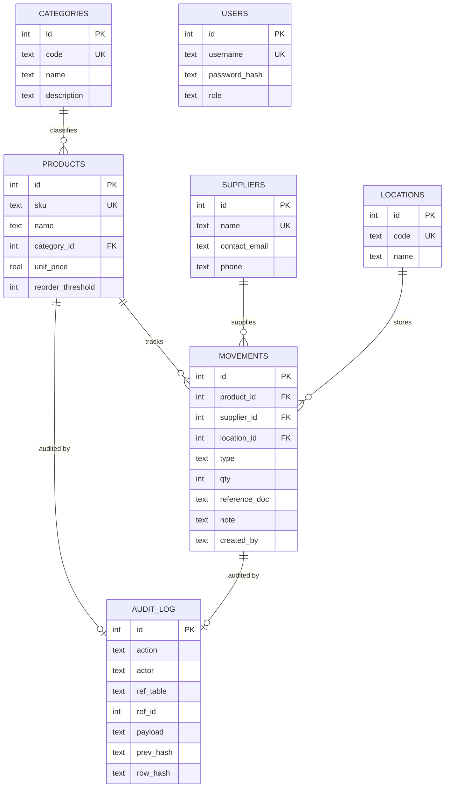
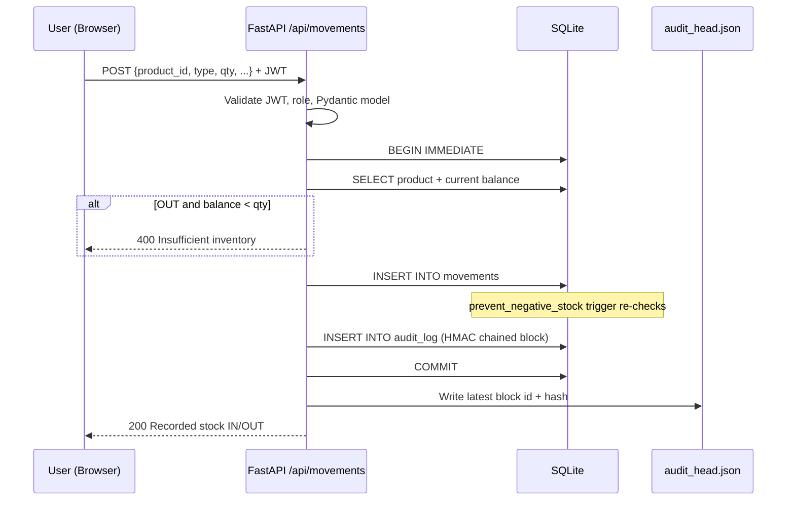
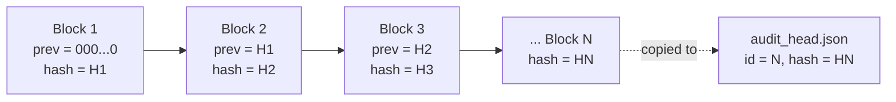
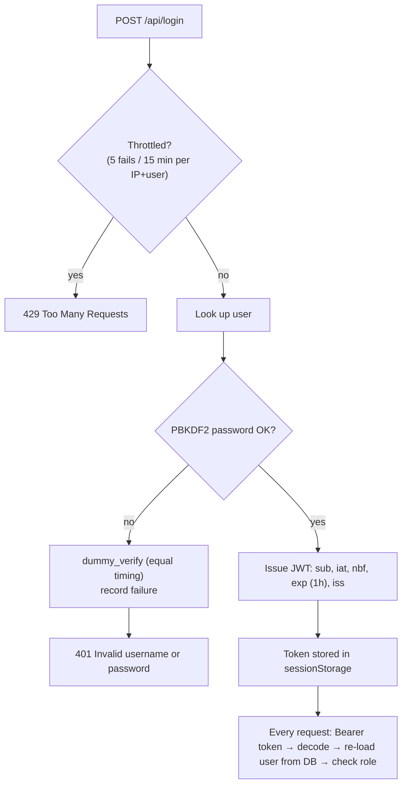

# VaultStock — Project Report

> **Relational Inventory Management with a Tamper-Evident Audit Ledger**
> Stack: SQLite 3 · Python FastAPI · Vanilla HTML/CSS/JavaScript

---

## 1. What is VaultStock? (In One Paragraph)

Most inventory systems store stock as a number and change it in place, e.g. `UPDATE products SET stock = stock - 5`. That approach loses history, breaks under concurrent users, and lets an insider quietly change numbers. **VaultStock never stores a stock number.** Every receipt and dispatch is saved as a permanent, append-only *movement* row, and the current stock is calculated by adding them up (`SUM(IN) − SUM(OUT)`). On top of that, every change is sealed into a **cryptographically chained audit log** (like Git commits). If anyone edits the database file behind the application's back, the chain breaks and the system reports exactly where.

---

## 2. Feature Summary

| # | Feature | What it means for the user | How it is built |
|---|---|---|---|
| 1 | **Derived stock balance** | Stock is always correct and matches history | SQL view `v_inventory_summary` sums the `movements` table |
| 2 | **Append-only movement ledger** | Past transactions can't be edited or deleted | SQLite `BEFORE UPDATE` / `BEFORE DELETE` triggers raise `ABORT` |
| 3 | **Overdraft protection** | You can't issue more stock than you have | App-level check + `prevent_negative_stock` trigger |
| 4 | **3NF normalized schema** | No duplicated data, clean relationships | 7 tables: users, categories, suppliers, locations, products, movements, audit_log |
| 5 | **Low-stock alerts** | Banner and KPI when items hit their reorder point | View `v_low_stock_alerts` (`current_stock <= reorder_threshold`) |
| 6 | **HMAC-SHA256 audit chain** | Every change is signed and linked to the previous one | `append_audit_entry()` in `api/db.py` |
| 7 | **5-point integrity verifier** | One click proves the database hasn't been tampered with | `verify_audit_chain()` — contiguity, linkage, HMAC, reconciliation, anchor |
| 8 | **External head anchor** | Detects deletion of the newest records | `data/audit_head.json` updated after every commit |
| 9 | **Role-based access (RBAC)** | Admin vs Staff permissions | JWT (HS256) + `require_role()` FastAPI dependency |
| 10 | **Hardened login** | Resistant to brute force and user enumeration | PBKDF2 (150k iterations), rate limiter, dummy hash timing |
| 11 | **Live tamper demo** | Show an attack and its detection live | `POST /api/audit/tamper-demo` (demo mode only) |
| 12 | **Live ER diagram & DB explorer** | See the real schema, keys, DDL and rows in the browser | SVG generated from `PRAGMA table_info` / `foreign_key_list` |
| 13 | **SQL & trigger probes** | Run `EXPLAIN QUERY PLAN` and attack attempts safely | `run_sql_probe()` — all writes are rejected or rolled back |
| 14 | **Light / Dark theme** | Comfortable viewing | CSS variables, preference saved in `localStorage` |

---

## 3. System Architecture



| Layer | File(s) | Responsibility |
|---|---|---|
| Launcher | `run_dev.py` | Starts static web server (port 3000) and Uvicorn API (port 8000); demo mode on by default |
| Config | `api/config.py` | Reads environment variables; auto-generates `data/.jwt_secret` and `data/.audit_key` on first run |
| Security | `api/security.py` | `hash_password`, `verify_password` (constant-time), `dummy_verify` |
| Data engine | `api/db.py` | Connections, `write_tx`, seeding, audit chain, verifier, tamper demo, reset, diagnostics |
| API | `api/main.py` | REST endpoints, validation, auth, error mapping, security headers, CORS |
| Schema | `db/schema.sql` | Tables, indexes, triggers, views |
| Frontend | `web/index.html`, `web/app.js`, `web/style.css` | 5-tab single-page dashboard |
| Tools | `inspect_db.py`, `extras/test_suite.py` | Terminal DB inspector & interactive SQL shell; 24-test automated suite |

---

## 4. The Database

### 4.1 Entity-Relationship Diagram



### 4.2 Tables at a Glance

| Table | Purpose | Key constraints |
|---|---|---|
| `users` | Login accounts | `username UNIQUE`, `role IN ('admin','staff')` |
| `categories` | Product groups | `code UNIQUE`, length checks |
| `suppliers` | Vendors for receipts | `name UNIQUE` |
| `locations` | Warehouses / retail floor | `code UNIQUE` |
| `products` | Catalog (**no stock column**) | `sku UNIQUE`, `unit_price > 0`, FK → categories `ON DELETE RESTRICT` |
| `movements` | Append-only stock ledger | `type IN ('IN','OUT')`, `qty` integer 1..1,000,000, FKs → products / suppliers / locations |
| `audit_log` | Hash-chained audit blocks | `ref_table IN ('products','movements')`, `UNIQUE(ref_table, ref_id)` |

### 4.3 Views (Derived Data)

| View | What it returns |
|---|---|
| `v_inventory_summary` | Each product + category, `current_stock`, `total_valuation` (stock × price), `is_low_stock` flag |
| `v_low_stock_alerts` | Rows of `v_inventory_summary` where `is_low_stock = 1` |
| `v_ledger_history` | Movements joined with product, category, supplier, location names — newest first |

The core calculation:

```sql
COALESCE(SUM(CASE WHEN m.type = 'IN' THEN m.qty ELSE -m.qty END), 0) AS current_stock
```

### 4.4 Triggers (Rules Enforced by the Database Itself)

| Trigger | Fires on | Effect |
|---|---|---|
| `prevent_negative_stock` | `BEFORE INSERT ON movements WHEN type='OUT'` | Aborts if balance < requested qty |
| `prevent_movement_update` | `BEFORE UPDATE ON movements` | Aborts — ledger is immutable |
| `prevent_movement_delete` | `BEFORE DELETE ON movements` | Aborts — ledger is immutable |
| `prevent_product_delete` | `BEFORE DELETE ON products` | Aborts — history must keep its references |
| `prevent_audit_update` | `BEFORE UPDATE ON audit_log` | Aborts — audit log is immutable |
| `prevent_audit_delete` | `BEFORE DELETE ON audit_log` | Aborts — audit log is immutable |

All messages start with `SECURITY VIOLATION:` so the API can recognise and report them cleanly.

### 4.5 Indexes

`idx_products_category_id`, `idx_movements_product_id`, `idx_movements_supplier_id`, `idx_movements_location_id` — they speed up the joins and the per-product `SUM()` used by the views and the overdraft trigger.

### 4.6 Normalization (3NF)

- **1NF** — every column holds a single value; every table has a primary key.
- **2NF** — every table has a single-column primary key, so partial dependencies cannot exist.
- **3NF** — no transitive dependencies: category, supplier and location details live in their own tables and are referenced only by ID. The stock balance is **not stored**, because it is derivable from `movements` (storing it would create redundancy and update anomalies).

### 4.7 Connection Settings

Every connection (`get_connection()`) runs:

| PRAGMA | Value | Why |
|---|---|---|
| `foreign_keys` | `ON` | SQLite ignores FKs unless enabled |
| `journal_mode` | `WAL` | Readers don't block the writer |
| `busy_timeout` | `10000` ms | Wait for a lock instead of failing immediately |

Writes use `write_tx()`, which issues **`BEGIN IMMEDIATE`** — the write lock is taken *before* the balance is read, so two users can't both pass the stock check and oversell.

### 4.8 Seed Data

On first start `init_db()` creates: 2 users (admin, staff), 4 categories, 3 suppliers, 3 locations, 6 products, 6 opening `IN` movements → **12 audit blocks**.

---

## 5. How It Works — Core Flows

### 5.1 Recording a Stock Movement



### 5.2 How an Audit Block is Built

For each new block, `append_audit_entry()`:

1. Reads the last block → `prev_hash` (or 64 zeros for block #1) and `next_id`.
2. Builds a **canonical JSON** snapshot of the row (sorted keys, no spaces) → `payload`.
3. Computes:

$$
\text{row\_hash} = \text{HMAC-SHA256}_{K}\big(\,[\text{prev\_hash}, \text{id}, \text{action}, \text{actor}, \text{ref\_table}, \text{ref\_id}, \text{payload}, \text{timestamp}]\,\big)
$$

where **K** is the secret key in `data/.audit_key` (or `VAULTSTOCK_AUDIT_KEY`), stored **outside** the database.



Changing anything in Block 1 changes H1, which no longer matches Block 2's `prev_hash` — and the attacker cannot recompute a valid HMAC without the key.

### 5.3 The 5-Point Verifier (`verify_audit_chain()`)

| # | Check | Question it answers | Catches |
|---|---|---|---|
| 1 | **Contiguity** | Are block IDs exactly 1, 2, …, N? | Deleted blocks in the middle |
| 2 | **Linkage** | Does each `prev_hash` equal the previous `row_hash`? | Re-ordered or spliced blocks |
| 3 | **HMAC Integrity** | Does the recomputed HMAC match `row_hash`? | Edited block contents, forged plain SHA-256 hashes |
| 4 | **Reconciliation** | Does every product/movement row have exactly one audit block with a matching snapshot, and vice-versa? | "Ghost" rows inserted directly, edited product prices, orphaned audit blocks |
| 5 | **Anchor** | Does the last block match `audit_head.json`? | Tail truncation (deleting the newest records) |

The verifier stops at the first failure and returns `verified`, `broken_at_id`, `reason` and the status of each check, which the UI shows as OK / FAIL tiles.

### 5.4 Login & Authorization



| Role | Can do |
|---|---|
| **Admin** | Everything: create products, record movements, simulate tamper, reset database |
| **Staff** | View everything, record IN/OUT movements, run verification and probes |

### 5.5 Tamper Simulation (Demo Mode)

`tamper_for_demo()` imitates an attacker with raw file access:

1. Drops the `prevent_audit_update` trigger (what an attacker with file access could do).
2. Edits block #1's `details` and replaces its `row_hash` with a **plain, unkeyed SHA-256** (the best an attacker can do without the key).
3. Re-creates the trigger so the database looks normal.

Running **Verify Chain** then fails at check 3: *"HMAC mismatch in block #1: data was altered."* **Reset Baseline** drops everything, runs `VACUUM`, and reseeds a clean database.

### 5.6 SQL Probes

The **ER Diagram & Schema** tab runs safe experiments through `POST /api/debug/sql-probe`:

| Probe | SQL attempted | Expected result |
|---|---|---|
| EXPLAIN Stock Plan | `EXPLAIN QUERY PLAN SELECT * FROM v_inventory_summary` | Shows index usage |
| Overdraft Guard | `INSERT ... 'OUT', 999999` | `INTERCEPTED` by `prevent_negative_stock` |
| Block UPDATE / DELETE Movement | `UPDATE/DELETE movements WHERE id=1` | `INTERCEPTED` |
| Block UPDATE Audit | `UPDATE audit_log ...` | `INTERCEPTED` |
| Block DELETE Product | `DELETE FROM products WHERE id=1` | `INTERCEPTED` |

Only these fixed probe names are accepted (Pydantic `Literal`), so this is not an arbitrary SQL console.

---

## 6. Security Measures

| Area | Measure |
|---|---|
| Passwords | Salted PBKDF2-HMAC-SHA256, 150,000 iterations, 16-byte salt, constant-time compare |
| User enumeration | Same error message and a dummy hash computation for unknown users |
| Brute force | Sliding-window limiter: 5 failures per 15 min per `IP:username` → `429` + `Retry-After` |
| Sessions | HS256 JWT, 1-hour expiry, issuer check; user and role re-read from DB on each request |
| Input validation | Pydantic v2 strict models (`extra="forbid"`), regex for SKU/username, numeric ranges, no NaN/Infinity, control characters rejected |
| SQL injection | All user values go through `?` placeholders; table names in debug tools are allow-listed |
| XSS | All dynamic text rendered through `escapeHtml()` |
| HTTP headers | `X-Content-Type-Options`, `X-Frame-Options: DENY`, `Referrer-Policy`, `Cache-Control: no-store`, CSP |
| CORS | Only `localhost:3000` / `127.0.0.1:3000` by default; only `GET`/`POST` |
| Production mode | With `VAULTSTOCK_DEMO_MODE` ≠ `1`: Swagger docs hidden, tamper/reset endpoints not registered, random seed passwords |
| Data integrity | Triggers (application layer bypass) + HMAC chain + reconciliation + anchor (file-level bypass) |

---

## 7. API Reference

| Method | Endpoint | Access | Purpose |
|---|---|---|---|
| POST | `/api/login` | Public | Get JWT |
| GET | `/api/config` | Public | Demo-mode flag for the login screen |
| GET | `/api/me` | Any | Current user profile |
| GET | `/api/categories`, `/api/suppliers`, `/api/locations` | Any | Lookup lists |
| GET | `/api/products` | Any | Catalog with derived stock (`v_inventory_summary`) |
| POST | `/api/products` | Admin | Create product + audit block |
| GET | `/api/inventory/alerts` | Any | Low-stock list |
| GET | `/api/movements?limit&offset` | Any | Ledger history (max 200 per page) |
| POST | `/api/movements` | Any | Record IN/OUT + audit block |
| GET | `/api/audit?limit&offset` | Any | Audit blocks, newest first |
| GET | `/api/audit/verify` | Any | Run 5-point verification |
| GET | `/api/debug/internals` | Any | PRAGMAs, row counts, triggers, views |
| GET | `/api/debug/full-schema` | Any | All tables & views: columns, FKs, DDL, rows |
| GET | `/api/debug/table/{name}` | Any | One table/view (allow-listed names only) |
| POST | `/api/debug/sql-probe` | Any | Run a predefined probe |
| POST | `/api/audit/tamper-demo` | Admin, demo only | Simulate file-level tampering |
| POST | `/api/reset-demo` | Admin, demo only | Reset and reseed database |

Interactive docs: `http://localhost:8000/docs` (demo mode only).

---

## 8. User Interface Walkthrough

### Getting Started

```powershell
pip install -r requirements.txt
python run_dev.py
```

The browser opens `http://localhost:3000`. Demo logins: **admin / vault-admin-2026** and **staff / vault-staff-2026** (or use the *Admin Role* / *Staff Role* quick buttons).

### Tab 1 — Inventory
- **4 KPI tiles:** registered SKUs, total units, total valuation, low-stock count.
- **Reorder alert banner** appears when any item is at or below its threshold.
- **Catalog table** with search, category filter and stock-status filter. Each row has **+ Receive** / **− Issue** shortcuts that jump to the Operations tab with the product pre-selected.
- **+ New SKU** (admin only) opens a modal; creating a product also seals an audit block.

### Tab 2 — Operations
- **Stock Receipt (IN):** product, supplier, location, quantity, reference doc (e.g. `PO-2026-108`), note.
- **Stock Dispatch (OUT):** shows *Available: N units* live and blocks over-issue in the browser, API and database.
- **Movement Ledger:** last 50 movements from `v_ledger_history`.

### Tab 3 — Audit Chain
- **Status tile:** green *100% VERIFIED* or red *TAMPER DETECTED* with the broken block number.
- **5-point matrix:** OK/FAIL for each check.
- **Buttons:** *Verify Chain*, and for admins *Simulate Disk Tamper* and *Reset Baseline*.
- **Block table:** block #, action, actor, target, timestamp, summary, first 16 chars of the HMAC (hover for full).
- The top bar shows chain status on every page.

### Tab 4 — ER Diagram & Schema
- **Engine tiles:** SQLite version, journal mode, DB size, FK enforcement, busy timeout.
- **Generated SVG ER diagram** built live from PRAGMA metadata (toggle to a card-style 3NF map). Clicking a table opens it in the explorer.
- **Table & Schema Explorer:** columns, types, PK/FK badges, compiled DDL, and raw rows for any table or view.
- **SQL & Trigger Probes** with the SQL, engine response and step-by-step explanation.
- **Row counts** and full definitions of all triggers and views.

### Tab 5 — Entire DB
- Every table and view on one page: schema, FK references, DDL, and up to 50 rows each. Filter by tables/views and jump links.

### Extras
- **Viva Guide** modal (top bar) with the elevator pitch and speaker roles.
- **Light/Dark** toggle on the login screen and top bar.

---

## 9. Testing & Verification

```powershell
python extras/test_suite.py
```

Runs against a separate test database (`data/vaultstock_test.db`) with random keys, and deletes it afterwards.

| Group | Tests | Covers |
|---|---|---|
| Auth & RBAC | T1–T5 | Missing token, valid token, staff on admin route, forged key, expired token |
| Validation & constraints | T6–T8, T18 | XSS payload storage, invalid FK, overdraft, duplicate SKU |
| Triggers | T9–T11 | Movement update/delete, audit update, product delete |
| Tamper detection | T12–T17 | Unkeyed hash, ghost row, deleted block, tail truncation, missing anchor, corrupt JSON |
| Schema & views | T19–T20 | Lookup tables seeded, view derives stock/valuation |
| Workflows | F1–F4 | Stock math (25 + 50 − 20 = 55), low-stock alert, full verify, reset |

Current result: **24 / 24 passed.**

Terminal inspection & query tool:

```powershell
python inspect_db.py            # dump all tables and views
python inspect_db.py products   # inspect one object
python inspect_db.py --shell    # interactive SQL prompt
```

---

## 10. Design Decisions & Trade-offs

| Decision | Benefit | Trade-off |
|---|---|---|
| Derive stock from movements | No redundancy, full history, no lost updates | `SUM()` grows with data → mitigated by index; large systems would add periodic snapshots |
| SQLite | Zero setup, real triggers & WAL, easy to demonstrate file-level tampering | Single writer; not for heavy multi-server workloads |
| Triggers *and* HMAC | Triggers stop app-level attacks; HMAC detects file-level attacks that bypass triggers | HMAC key must be protected and backed up |
| External anchor file | Detects deletion of newest records | Must be kept somewhere the attacker can't also rewrite (in production: separate server/WORM storage) |
| Products not deletable | Ledger never points to missing products | Discontinued items stay in the catalog |

### Known Limitations
- Tamper-*evident*, not tamper-*proof*: changes are detected, not prevented, at the file level.
- The key and anchor live in `data/` next to the DB for convenience; production should move them off-host.
- Rate-limiter state is in memory (reset on restart; single process only).
- The location used for an `OUT` is recorded but stock is not tracked per location.

---

## 11. Glossary

| Term | Meaning |
|---|---|
| **Append-only ledger** | A table where rows are only ever added, never changed or removed |
| **Derived attribute** | A value computed from other data instead of stored |
| **Trigger** | SQL code the database runs automatically before/after a change |
| **WAL** | Write-Ahead Logging — SQLite mode allowing reads during writes |
| **BEGIN IMMEDIATE** | Starts a transaction and takes the write lock straight away |
| **HMAC** | A hash that also requires a secret key — can't be forged without it |
| **Canonical JSON** | JSON with sorted keys and fixed formatting, so the same data always hashes the same |
| **Anchor** | An external copy of the latest block's ID and hash |
| **Reconciliation** | Comparing real table rows with what the audit log says they should be |
| **RBAC** | Role-Based Access Control |
| **JWT** | JSON Web Token — a signed login token |

