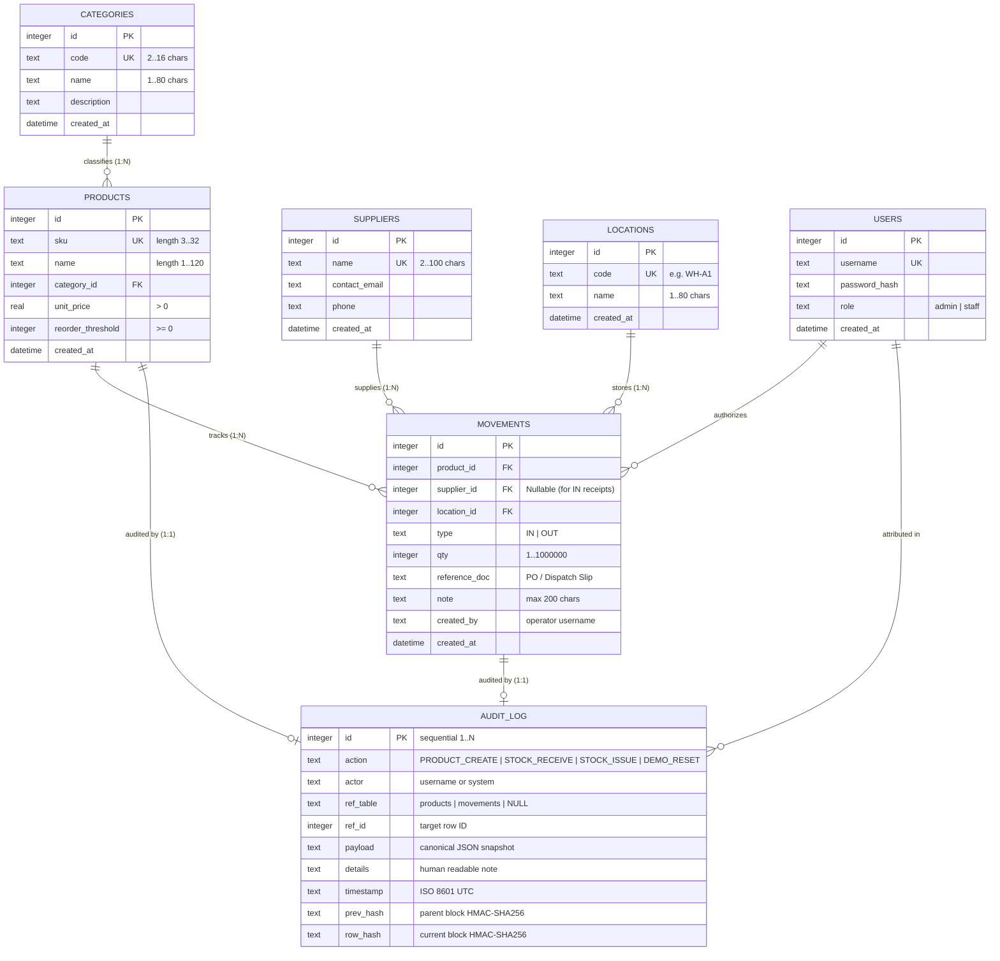

# VaultStock: Entity-Relationship (ER) Diagram 📐

---

## Relational Cardinalities & Constraints

### 1. `CATEGORIES` to `PRODUCTS` (1 : N)
- **Cardinality:** One product category classifies one or more catalog products.
- **Foreign Key:** `products.category_id REFERENCES categories(id) ON DELETE RESTRICT`.

### 2. `SUPPLIERS` to `MOVEMENTS` (1 : N)
- **Cardinality:** One supplier can fulfill zero or multiple inward stock receipts (`IN`).
- **Foreign Key:** `movements.supplier_id REFERENCES suppliers(id) ON DELETE RESTRICT`.

### 3. `LOCATIONS` to `MOVEMENTS` (1 : N)
- **Cardinality:** One warehouse/retail location holds multiple stock movement transactions.
- **Foreign Key:** `movements.location_id REFERENCES locations(id) ON DELETE RESTRICT`.

### 4. `PRODUCTS` to `MOVEMENTS` (1 : N)
- **Cardinality:** One catalog product has multiple historical ledger entries.
- **Foreign Key:** `movements.product_id REFERENCES products(id) ON DELETE RESTRICT`.
- **Integrity Rule:** `products` cannot be deleted (`prevent_product_delete` trigger) to ensure referential integrity for historical movements.

### 5. `MOVEMENTS` & `PRODUCTS` to `AUDIT_LOG` (1 : 1 Polymorphic Reference)
- **Constraint:** `UNIQUE(ref_table, ref_id)` on `audit_log`.
- **Integrity Rule:** Every product creation and movement insertion is paired with exactly one cryptographic audit block.

### 6. `AUDIT_LOG` to `AUDIT_LOG` (Self-Referential Cryptographic Chaining)
- Block $\#k$ stores `prev_hash` equal to `row_hash` of block $\#(k-1)$.
- Block $\#1$ (Genesis) sets `prev_hash = "0000000000000000000000000000000000000000000000000000000000000000"`.
- Guaranteed continuous sequence without gaps via contiguity verification ($id = 1 \dots N$).
