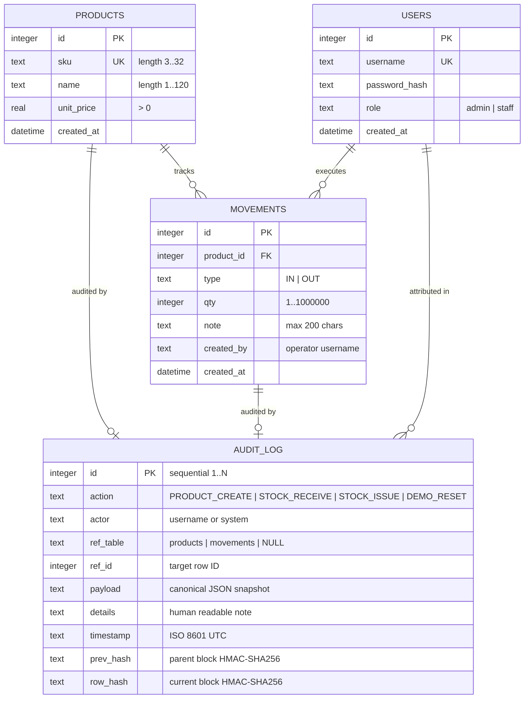

# VaultStock: Entity-Relationship (ER) Diagram 📐

---

## Relational Cardinalities & Constraints

### 1. `PRODUCTS` to `MOVEMENTS` (1 : N)
- **Cardinality:** One catalog product has zero or many historical movement entries.
- **Foreign Key:** `movements.product_id REFERENCES products(id)`.
- **Integrity Rule:** `products` cannot be deleted (`prevent_product_delete` trigger), ensuring historical movement references are permanently referentially intact.

### 2. `MOVEMENTS` to `AUDIT_LOG` (1 : 1 Polymorphic Reference)
- **Constraint:** `UNIQUE(ref_table, ref_id)` on `audit_log`.
- **Integrity Rule:** Every movement row inserted into `movements` is paired with exactly one corresponding entry in `audit_log` where `ref_table = 'movements'` and `ref_id = movements.id`.

### 3. `PRODUCTS` to `AUDIT_LOG` (1 : 1 Polymorphic Reference)
- **Constraint:** `UNIQUE(ref_table, ref_id)` on `audit_log`.
- **Integrity Rule:** Every product created is paired with an audit block where `ref_table = 'products'` and `ref_id = products.id`.

### 4. `USERS` to `MOVEMENTS` & `AUDIT_LOG` (Logical Attribution)
- Every transaction captures the authenticated username (`created_by`, `actor`) from the decoded JWT payload.

### 5. `AUDIT_LOG` to `AUDIT_LOG` (Self-Referential Cryptographic Chaining)
- Block $\#k$ embeds `prev_hash` equal to `row_hash` of block $\#(k-1)$.
- Block $\#1$ (Genesis) sets `prev_hash = "0000000000000000000000000000000000000000000000000000000000000000"`.
- Guaranteed continuous sequence without gaps via contiguity verification ($id = 1 \dots N$).

---

## Design Decision: Derived Balances vs. Mutable Quantity

| Attribute | Traditional Approach (Anti-pattern) | VaultStock Architecture |
|---|---|---|
| **Stock Storage** | Stored in `products.stock` as an integer. | **Derived attribute:** Computed on demand via `SUM(IN) - SUM(OUT)` from `movements`. |
| **Updates** | Direct `UPDATE products SET stock = stock - ?`. | **Append-only:** `INSERT INTO movements (type, qty, ...)` followed by trigger validation. |
| **Auditability** | Lost history; cannot trace when, why, or who altered quantities. | Complete chronological paper trail of every physical unit entering or leaving the vault. |
| **Concurrency Anomaly** | Lost updates, race condition oversells, phantom counts. | Serialized atomic writes (`BEGIN IMMEDIATE`), database trigger guards against negative balances. |
